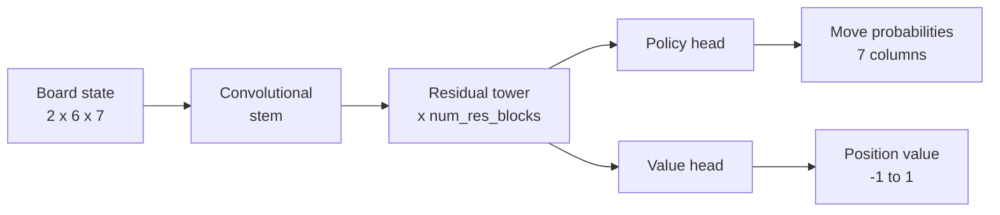
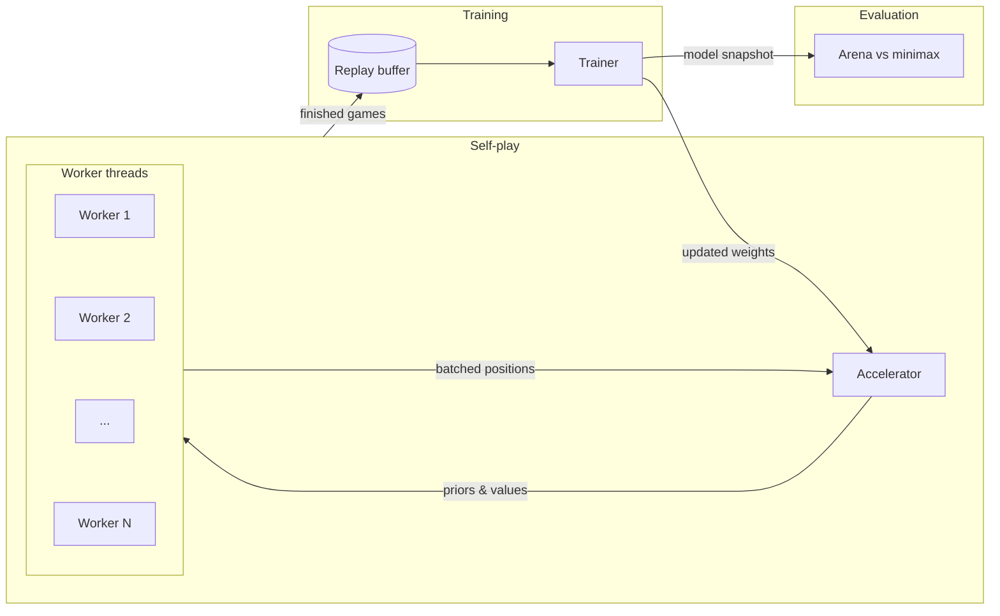

# AlphaConnect4-Zero

## Table of Contents

1. [Overview](#overview)
2. [Getting Started](#getting-started)
3. [Features](#features)
4. [Architecture](#architecture)
5. [Configuration](#configuration)
6. [Results](#results)
7. [References](#references)

## Overview

AlphaConnect4-Zero is an AlphaZero-style Connect 4 agent written in Rust with [Burn](https://burn.dev). It is entirely using reinforcement learning to continually improve through self-play.

## Getting Started

### Train

```sh
cargo run --release
```

This reads `training.toml` from the project root. To use a different config file, pass its path:

```sh
cargo run --release -- path/to/config.toml
```

Training runs until `total_updates` is reached. Checkpoints and metrics are written to `checkpoints/`. Open `checkpoints/metrics.html` to watch training progress live.

To resume from a checkpoint, set `initial_checkpoint` under `[model]` in `training.toml`.

### Play Against the Model

Set `model_path` under `[play]` in `training.toml` to a checkpoint, then run:

```sh
cargo run --release -- play
```

## Features

- **Pure self-play learning.** Trains entirely through games played against itself.
- **Concurrent self-play, training, and evaluation.** Training and evaluating the model occurs concurrently to imrpove performance, as the training loop generates training data through multiple self-play workers simulating games streaming them toa. replay buffer where the trainer samples from continuously. Likewise the Evaluator concurrently compares the currently trained model against minimax runs in the background without pausing training
- **Batched self-play inference.** Self-play runs across many worker threads, each playing several games at once. Instead of having one thread call the network at each leaf node which bottlenecks the GPU, we batch requests across multiple threads and send those requests to an accelerator which runs the network on the batch and sends each worker the results, speeding up self-play generation.
- **Benchmarking against minimax.** Every `every_updates` updates the current model plays an alpha-beta minimax opponent at configurable depths. Results are recorded as win, loss, and draw counts and an Elo estimate. Evaluation runs in the background without pausing training.
- **Live metrics.** Loss curves, evaluation results, and timing data are written as CSV files and as live HTML dashboards.
- **Terminal play.** Play against any checkpoint from the command line.

## Architecture

### Board Representation

The board is stored as two 64-bit bitboards, one per player, with 7 bits per column (6 playable rows plus a sentinel bit). Moves and win checks are bit operations.

The network input is two 6x7 planes from the point of view of the player to move (2 x 6 x 7).

### Neural Network (`ZeroNet`)



**Residual blocks.** Each block is Conv 3x3 → BatchNorm → ReLU → Conv 3x3 → BatchNorm, then adds the block's input and applies ReLU. All convolutions use same padding. The current configuration uses `hidden_size = 64` and `num_res_blocks = 7`, about half a million parameters.

**Policy head.** Conv 1x1 (hidden_size → 1) → BatchNorm → ReLU → flatten (42) → Linear (42 → 7). The outputs are logits over the 7 columns. At inference they are masked to legal moves and passed through a softmax to produce the search priors.

**Value head.** Conv 1x1 (hidden_size → 1) → BatchNorm → ReLU → flatten (42) → Linear (42 → 1) → tanh. The output is the expected result from the current player's perspective: +1 for a win, 0 for a draw, -1 for a loss.

### Monte Carlo Tree Search

Each move runs `simulations` iterations of the following:

1. **Select.** Starting at the root, repeatedly pick the child that balances exploiting moves that are more advantageous to the current player while exploring possible options using the puct score: `Q + c_puct · P · sqrt(N_parent) / (1 + N_child)`, where `P` is the network prior, `Q` is the child's average value from the current player's perspective, and `N` are visit counts.
2. **Expand and evaluate.** When encountering a new nonterminal board state, we evaluate the node using the Neural Network to determine the prior probabilities of each of its potential actions and the value between -1 and 1 on how favorable the network thinks that board position is. If the position is a terminal state, we use the exact result than evaluating with the network.
3. **Backpropagate.** The evaluated value is propagated back through every move taken in the simulation, updating the visit count and mean action value.

Search details:

- **Dirichlet noise** is mixed into the root node's priors during self-play, to encourage exploration when running simulations.
- **Temperature** controls move sampling distributions after all simulations are complete. The visit-count distribution is raised to `1 / T`, with `T` decaying linearly from `temperature_start` to `temperature_end` over the first `temperature_decay_moves` moves. Later moves are close to greedy.
- **Training target.** Analogous to the original AlphaZero implementation, The policy target is the root's raw visit-count distribution.

### Self-Play and Training Loop



1. **Self-play workers** (`threads` OS threads, each playing `games_per_thread` games concurrently) run MCTS and send leaf positions to the accelerator.
2. **The accelerator** Collects one request from each active worker evaluating all of their positions in a single batched forward pass and propagating the results to their respective workers.
3. **Finished games** represents the final labeled board state labeled with the final result: each position gets +1, 0, or -1 from the perspective of the player to move there. The positions are stored together with their MCTS visit distribution in the replay buffer.
4. **The replay buffer** is a queue that keeps the most recent `replay_capacity_games` complete games. Batches are sampled uniformly from all of their positions.
5. **The trainer** minimizes `policy_cross_entropy + value_mse + l2_coefficient · ||weights||²` with Adam.
6. **Weight refresh.** Every `model_refresh_per_updates` updates the self-play evaluator switches to the latest weights.
7. **Evaluation.** Every `every_updates` updates a snapshot of the model and evaluates its performance against a minimax opponent in a background thread.

## Configuration

All settings live in `training.toml`.

### `[self_play]`

| Key | Description |
| --- | --- |
| `threads` | Self-play worker threads |
| `games_per_thread` | Games each worker plays concurrently |
| `model_refresh_per_updates` | Updates between pushing fresh weights to the self-play evaluator |
| `simulations` | MCTS simulations per move |
| `dirichlet_alpha` | Concentration of the root exploration noise |
| `dirichlet_epsilon` | Weight of the noise in the root priors |
| `temperature_start`, `temperature_end` | Sampling temperature at move 0 and after the decay |
| `temperature_decay_moves` | Moves over which temperature decays linearly |

### `[evaluation]`

| Key | Description |
| --- | --- |
| `threads` | Evaluation worker threads |
| `games_per_thread` | Games each evaluation thread plays concurrently |
| `every_updates` | Updates between evaluations |
| `depths` | Minimax depths to play against |
| `games` | Games per depth. Must be even so that every opening is played from both sides. |
| `simulations` | MCTS simulations per move for the model during evaluation |

### `[search]`

| Key | Description |
| --- | --- |
| `c_puct` | Exploration constant in the PUCT formula |

### `[model]`

| Key | Description |
| --- | --- |
| `hidden_size` | Channels in the convolutional layers |
| `num_res_blocks` | Number of residual blocks |
| `initial_checkpoint` | Optional path to a checkpoint to resume from |

### `[training]`

| Key | Description |
| --- | --- |
| `total_updates` | Gradient updates before training stops |
| `batch_size` | Positions per update |
| `replay_capacity_games` | Complete games kept in the replay buffer |
| `learning_rate` | Adam learning rate |
| `l2_coefficient` | Weight of the L2 penalty in the loss |
| `checkpoint_every_updates` | Updates between saved checkpoints |
| `checkpoint_dir` | Directory for checkpoints and metrics |

### `[play]`

| Key | Description |
| --- | --- |
| `model_path` | Checkpoint loaded by `cargo run --release -- play` |
| `simulations` | MCTS simulations per model move |

The `[model]` dimensions must match the checkpoint being loaded, for both resuming training and playing.

## Results

### Model

The model I currently play against is the **step 59,000** checkpoint (`checkpoints/model-step-59000.mpk`), one of the two strongest periodic evaluations of this training run (it has the best depth 8 result, and only step 60,000 scored slightly higher against depth 6).

### Training Configuration

| Setting | Value |
| --- | --- |
| Network | 7 residual blocks, 64 channels |
| Self-play | 16 threads × 64 concurrent games, 600 simulations per move |
| Exploration | Dirichlet α 0.3, ε 0.25; temperature 1.0 → 0.1 over 10 moves |
| `c_puct` | 1.0 |
| Batch size | 512 |
| Replay buffer | 400 games |
| Optimizer | Adam, learning rate 0.001, L2 coefficient 0.0001 |
| Weight refresh | Every 50 updates |
| Evaluation | Every 1,000 updates, 100 games each against minimax depth 6 and depth 8, 600 simulations per move |

### Hardware and Training Time

Trained on a single MacBook Pro with an Apple M4 (10 cores: 4 performance and 6 efficiency) and 16 GB of unified memory, with the network running on the GPU through Metal.

| | |
| --- | --- |
| Time to reach step 59,000 | about 16 hours |
| Average update time | about 0.7 seconds |
| Self-play games over the whole run | 62,361 games, 2.23 million positions (about 36 moves per game) |

### Training Metrics

Averages over the 100 updates ending at each step:

| Step | Policy loss | Value loss | Value MAE | Policy entropy |
| --- | --- | --- | --- | --- |
| 1,000 | 1.428 | 0.322 | 0.379 | 1.445 |
| 10,000 | 0.632 | 0.141 | 0.219 | 0.633 |
| 30,000 | 0.808 | 0.188 | 0.227 | 0.807 |
| 59,000 | 0.800 | 0.175 | 0.212 | 0.801 |

The policy loss and entropy rise after step 10,000 even though play keeps getting stronger. This is expected: as the model improves, its self-play opponent does too, so the games get harder and the training targets more uncertain.

### Evaluation Performance against Minimax

100 games per depth from a suite of randomized openings, each played from both sides. The model searches 600 simulations per move during evaluation. Score rate counts a draw as half a win.

| Opponent | Wins | Losses | Draws | Score rate | Elo vs. opponent | As first player | As second player |
| --- | --- | --- | --- | --- | --- | --- | --- |
| Minimax depth 6 | 83 | 12 | 5 | 0.855 | +308 | 0.89 | 0.82 |
| Minimax depth 8 | 76 | 18 | 6 | 0.790 | +230 | 0.85 | 0.73 |

## References

- Silver, D., et al. [Mastering Chess and Shogi by Self-Play with a General Reinforcement Learning Algorithm](https://arxiv.org/abs/1712.01815). arXiv:1712.01815, 2017.
